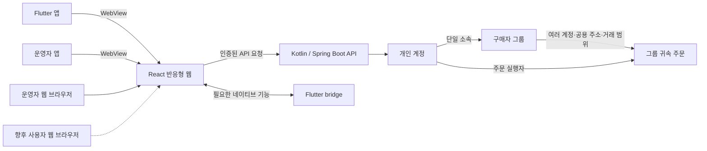
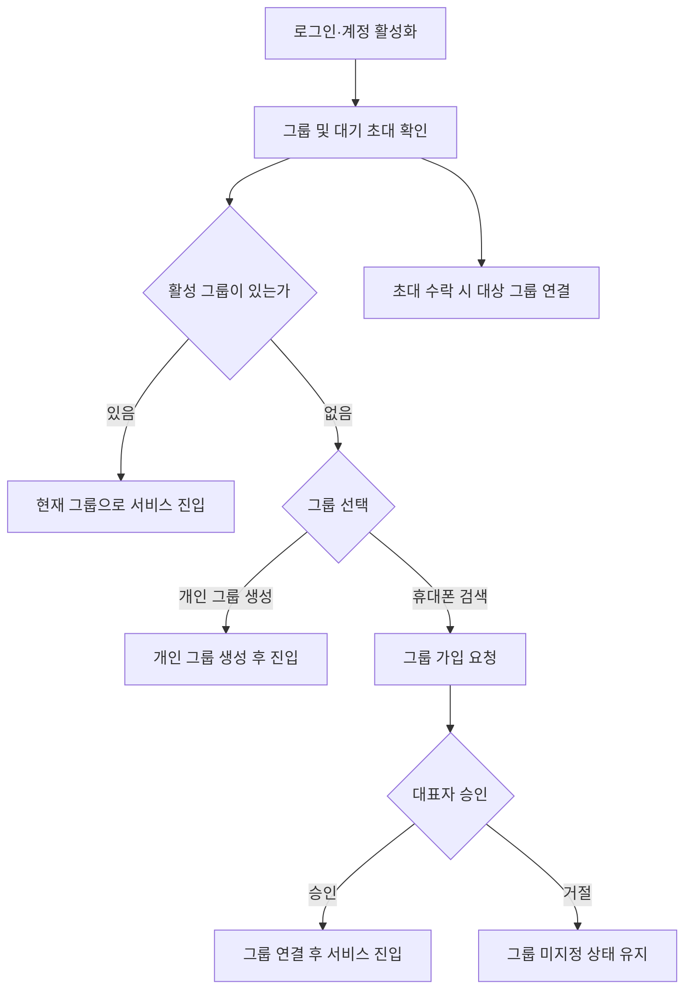

# 엄지마켓 Web

React 기반 판매·운영 화면. 
Flutter 앱의 WebView에서 제공하며 운영자는 웹 브라우저에서도 이용할 수 있음. 
사용자 웹 이용은 향후 제공을 계획하며, 화면은 모바일·태블릿·데스크톱에 대응하는 반응형으로 설계. 

## 전체 연결 구조

화면과 API 계약은 앱과 웹 환경에서 가능한 범위 내 공유함. 
Flutter bridge는 카메라·파일 등 웹만으로 처리하기 어려운 네이티브 기능에 한해 사용. 
채널별 제공 시점과 기능은 사용자 흐름을 따르며, 화면별 권한은 서버 API에서 다시 검사. 

## 회원 진입과 그룹

1. 앱은 사용자와 운영자가 이용. 운영자는 웹 브라우저에서도 이용하며, 사용자 웹 이용은 향후 제공을 계획. 
2. 앱 회원 진입은 휴대폰 인증 기반. 웹 인증 API는 제공되지만 사용자 웹 이용은 향후 제공 범위이며, 최초 비밀번호 설정·복구 본인 확인 정책은 미구현. 
3. 인증 후 계정 상태를 확인하고, 필요한 개인정보 동의·프로필 입력·운영 검토 단계를 안내.
4. 계정은 구매자 그룹 하나에 소속되고 그룹에는 여러 계정이 소속될 수 있음. 그룹 미지정 계정은 개인 그룹을 만들거나 기존 그룹 가입을 요청하는 onboarding을 거침.
5. 사업자번호는 그룹 소속의 필수 조건이 아님. 사업자 업체, 사업자번호가 없는 업체, 개인 구매 그룹을 지원.
6. 주문은 주문 실행 계정과 구매자 그룹에 함께 귀속. 그룹 구성원은 그룹 범위 주문·공용 배송지·거래 이력을 조회하고 주문자는 휴대폰 번호 일부로 구분.

현재 인증·계정·그룹 정책과 Mermaid 흐름: [`SERVICE_FLOW.md`](../SERVICE_FLOW.md). API 그룹 계약 및 권한 세부 기준: [`umji-market-api/docs/services/account.md`](../umji-market-api/docs/services/account.md).

Access Token은 메모리에 보관하고 Refresh Token 기반 세션 갱신·계정 상태 재검증을 수행. 세션 만료, 외부 결제 복귀, 파일 업로드, 앱 뒤로가기 흐름은 각 기능의 API·Flutter bridge 계약에 맞춰 관리.

## 개발 실행

Node.js 20.19 이상 환경에서 `pnpm install`, `pnpm dev` 순서로 실행. 
개발 서버는 기본적으로 `http://localhost:5173`에서 실행하고 `/api` 요청은 `http://localhost:8080` API로 전달. 
API 주소 변경은 `.env.local`의 `VITE_API_PROXY_TARGET` 및 `VITE_API_BASE_URL`로 설정. 
빌드 검증은 `pnpm build`, 타입 검증은 `pnpm typecheck` 사용. 

## 프론트 구조

`src/app`은 라우트와 화면 접근 경계, `src/features`는 업무 기능과 API 계약, `src/shared`는 공통 API client, `src/pages`는 경로별 화면을 관리. 
Access Token은 메모리에만 보관하며 `localStorage`를 사용하지 않음. 앱 재실행 후 Refresh Token 복구는 Flutter secure storage bridge 계약 확정 후 연결 예정. 
현재 실제 인증 연동은 `POST /api/auth/login`과 token 갱신·폐기 endpoint까지. 신규 사용자 본인 확인 및 가입 API는 백엔드 미구현 상태를 화면 분기에 그대로 노출. 
